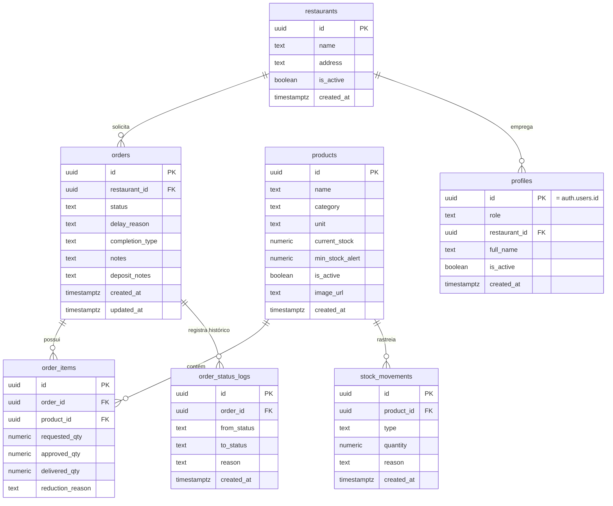

# 🗄️ Dicionário de Dados & Schema do Supabase — InsumoSync

Este documento contém a especificação técnica completa de tabelas, tipos de dados, chaves primárias, relacionamentos, políticas de RLS e Stored Procedures (RPCs) no PostgreSQL / Supabase.

---

## 1. Diagrama Entidade-Relacionamento (ERD)



---

## 2. Tabelas e Estrutura

### 2.1 `restaurants`
| Coluna | Tipo | Restrições | Descrição |
| :--- | :--- | :--- | :--- |
| `id` | `UUID` | `PRIMARY KEY DEFAULT gen_random_uuid()` | Identificador único do restaurante |
| `name` | `TEXT` | `NOT NULL` | Nome fantasia da unidade |
| `address` | `TEXT` | `NULL` | Endereço físico do restaurante |
| `is_active` | `BOOLEAN` | `DEFAULT true` | Status de ativação da filial |
| `created_at` | `TIMESTAMPTZ` | `DEFAULT now()` | Data de criação |

### 2.2 `products`
| Coluna | Tipo | Restrições | Descrição |
| :--- | :--- | :--- | :--- |
| `id` | `UUID` | `PRIMARY KEY DEFAULT gen_random_uuid()` | Identificador único do insumo |
| `name` | `TEXT` | `NOT NULL` | Nome do insumo (ex: *Filé Mignon*, *Tomate Italiano*) |
| `category` | `TEXT` | `NOT NULL` | Categoria (*Carnes & Aves*, *Hortifrúti*, *Laticínios*, etc.) |
| `unit` | `TEXT` | `NOT NULL` | Unidade de medida (`KG`, `UN`, `L`, `CX`, `PCT`) |
| `current_stock` | `NUMERIC` | `NOT NULL DEFAULT 0 CHECK (current_stock >= 0)` | Saldo atual no depósito central |
| `min_stock_alert`| `NUMERIC` | `NOT NULL DEFAULT 5` | Ponto de pedido para alerta de estoque crítico |
| `is_active` | `BOOLEAN` | `NOT NULL DEFAULT true` | Insumo visível no catálogo. `false` é o soft-delete: some do catálogo do restaurante e preserva todo o histórico |
| `image_url` | `TEXT` | `NULL` | URL pública da imagem recortada (1:1 WebP) no Supabase Storage ou DataURL no mock |
| `created_at` | `TIMESTAMPTZ` | `DEFAULT now()` | Data de cadastro |

> Índice `idx_products_is_active` em `is_active`, usado pelo filtro padrão do catálogo.

### 2.3 `orders`
| Coluna | Tipo | Restrições | Descrição |
| :--- | :--- | :--- | :--- |
| `id` | `UUID` | `PRIMARY KEY DEFAULT gen_random_uuid()` | Identificador único do pedido |
| `restaurant_id`| `UUID` | `REFERENCES restaurants(id) ON DELETE CASCADE` | Filial solicitante |
| `status` | `TEXT` | `NOT NULL DEFAULT 'ABERTO'` | Status atual na máquina de estados |
| `delay_reason` | `TEXT` | `NULL` | Motivo de atraso (*Falta de Produto* / *Transporte*) |
| `completion_type` | `TEXT` | `NULL` | Desfecho da entrega (`TOTAL`, `PARCIAL`, `NAO_ENTREGUE`) |
| `notes` | `TEXT` | `NULL` | Observações gerais do pedido, escritas pelo restaurante |
| `deposit_notes` | `TEXT` | `NULL` | Recados do depósito ao motorista e ao restaurante, preenchidos na triagem |
| `created_at` | `TIMESTAMPTZ` | `DEFAULT now()` | Data e hora de criação |
| `updated_at` | `TIMESTAMPTZ` | `DEFAULT now()` | Data e hora da última alteração |

### 2.4 `order_items`
| Coluna | Tipo | Restrições | Descrição |
| :--- | :--- | :--- | :--- |
| `id` | `UUID` | `PRIMARY KEY DEFAULT gen_random_uuid()` | Identificador único do item |
| `order_id` | `UUID` | `REFERENCES orders(id) ON DELETE CASCADE` | Pedido associado |
| `product_id` | `UUID` | `REFERENCES products(id) ON DELETE RESTRICT` | Insumo requisitado |
| `requested_qty`| `NUMERIC` | `NOT NULL CHECK (requested_qty > 0)` | Quantidade solicitada pelo restaurante |
| `approved_qty` | `NUMERIC` | `NULL` | Quantidade aprovada pelo depósito. **É o saldo efetivamente retido do estoque** enquanto o pedido não é terminal |
| `delivered_qty`| `NUMERIC` | `NULL` | Quantidade recebida na entrega |
| `reduction_reason` | `TEXT` | `NULL` | Justificativa individual obrigatória quando `approved_qty < requested_qty` |

> O `ON DELETE RESTRICT` em `product_id` é o que torna a remoção definitiva de um
> insumo impossível assim que ele participa de qualquer pedido — a garantia física
> de integridade do histórico.

### 2.5 `order_status_logs`
| Coluna | Tipo | Restrições | Descrição |
| :--- | :--- | :--- | :--- |
| `id` | `UUID` | `PRIMARY KEY DEFAULT gen_random_uuid()` | Identificador do log |
| `order_id` | `UUID` | `REFERENCES orders(id) ON DELETE CASCADE` | Pedido monitorado |
| `from_status` | `TEXT` | `NULL` | Status anterior |
| `to_status` | `TEXT` | `NOT NULL` | Novo status assumido |
| `reason` | `TEXT` | `NULL` | Justificativa ou observação da mudança |
| `created_at` | `TIMESTAMPTZ` | `DEFAULT now()` | Timestamp exato da transição |

### 2.6 `stock_movements`
| Coluna | Tipo | Restrições | Descrição |
| :--- | :--- | :--- | :--- |
| `id` | `UUID` | `PRIMARY KEY DEFAULT gen_random_uuid()` | Identificador da movimentação |
| `product_id` | `UUID` | `REFERENCES products(id) ON DELETE CASCADE` | Insumo movimentado |
| `type` | `TEXT` | `NOT NULL` | `ENTRADA_MANUAL`, `SAIDA_PEDIDO`, `ESTORNO_CANCELAMENTO` |
| `quantity` | `NUMERIC` | `NOT NULL` | Quantidade movimentada (positiva ou negativa) |
| `reason` | `TEXT` | `NULL` | Motivo ou número do pedido |
| `created_at` | `TIMESTAMPTZ` | `DEFAULT now()` | Data e hora do movimento |

### 2.7 `profiles`
| Coluna | Tipo | Restrições | Descrição |
| :--- | :--- | :--- | :--- |
| `id` | `UUID` | `PRIMARY KEY REFERENCES auth.users(id) ON DELETE CASCADE` | Mesmo id do usuário no Supabase Auth |
| `role` | `TEXT` | `NOT NULL CHECK (role IN ('estoque','restaurante','admin'))` | Papel do usuário |
| `restaurant_id` | `UUID` | `REFERENCES restaurants(id)` | Restaurante do usuário. Obrigatório quando `role = 'restaurante'` (`CHECK`) |
| `full_name` | `TEXT` | `NOT NULL` | Nome exibido na barra de navegação |
| `is_active` | `BOOLEAN` | `NOT NULL DEFAULT true` | `false` bloqueia o usuário por completo |
| `created_at` | `TIMESTAMPTZ` | `NOT NULL DEFAULT now()` | Data de criação do perfil |

> RLS: o usuário lê só a própria linha (`id = auth.uid()`). Não há policy de escrita; perfis são criados pelo administrador via SQL (seção 4.4).

### 2.8 `kitchen_stock`
| Coluna | Tipo | Restrições | Descrição |
| :--- | :--- | :--- | :--- |
| `restaurant_id` | `UUID` | `PK`, `REFERENCES restaurants(id) ON DELETE CASCADE` | Restaurante dono do saldo |
| `product_id` | `UUID` | `PK`, `REFERENCES products(id) ON DELETE RESTRICT` | Insumo |
| `quantity` | `NUMERIC` | `NOT NULL DEFAULT 0 CHECK (quantity >= 0)` | Saldo atual na cozinha |
| `last_counted_at` | `TIMESTAMPTZ` | `NULL` | Última vez que o insumo foi contado |
| `updated_at` | `TIMESTAMPTZ` | `NOT NULL DEFAULT now()` | Última alteração |

### 2.9 `kitchen_counts`
| Coluna | Tipo | Restrições | Descrição |
| :--- | :--- | :--- | :--- |
| `id` | `UUID` | `PRIMARY KEY DEFAULT gen_random_uuid()` | Identificador da contagem |
| `restaurant_id` | `UUID` | `NOT NULL REFERENCES restaurants(id) ON DELETE CASCADE` | Restaurante |
| `counted_by` | `UUID` | `REFERENCES auth.users(id)` | Usuário que contou |
| `is_initial` | `BOOLEAN` | `NOT NULL DEFAULT false` | Contagem inicial (única por restaurante, índice parcial) |
| `items_counted` | `INT` | `NOT NULL` | Quantos insumos foram informados |
| `created_at` | `TIMESTAMPTZ` | `NOT NULL DEFAULT now()` | Momento da contagem |

### 2.10 `kitchen_movements`
| Coluna | Tipo | Restrições | Descrição |
| :--- | :--- | :--- | :--- |
| `id` | `UUID` | `PRIMARY KEY DEFAULT gen_random_uuid()` | Identificador |
| `restaurant_id` | `UUID` | `NOT NULL REFERENCES restaurants(id) ON DELETE CASCADE` | Restaurante |
| `product_id` | `UUID` | `NOT NULL REFERENCES products(id) ON DELETE RESTRICT` | Insumo |
| `type` | `TEXT` | `CHECK (type IN ('CONTAGEM_INICIAL','ENTRADA_ENTREGA','PERDA','CONSUMO_APURADO','AJUSTE_POSITIVO'))` | Tipo (business-rules 5.A.1) |
| `quantity` | `NUMERIC` | `NOT NULL` | Positiva para entradas, negativa para saídas |
| `reason` | `TEXT` | `NULL` | Motivo da perda ou observação |
| `order_id` | `UUID` | `REFERENCES orders(id)` | Pedido, em `ENTRADA_ENTREGA` |
| `count_id` | `UUID` | `REFERENCES kitchen_counts(id)` | Contagem, em `CONTAGEM_INICIAL`/`CONSUMO_APURADO`/`AJUSTE_POSITIVO` |
| `created_by` | `UUID` | `REFERENCES auth.users(id)` | Autor |
| `created_at` | `TIMESTAMPTZ` | `NOT NULL DEFAULT now()` | Momento |

> RLS das três tabelas: `SELECT` para `admin` ou para o próprio restaurante. Sem policy de escrita; tudo passa pelas RPCs.

---

## 3. Stored Procedures (RPCs)

1. **`place_order_with_reservation(p_restaurant_id uuid, p_items jsonb, p_notes text)`**:
   - Trava as linhas em `products` com `SELECT ... FOR UPDATE`.
   - Verifica estoque de todos os itens atomicamente.
   - Deduz `current_stock`, cria `orders`, `order_items`, `order_status_logs` e `stock_movements`.
   - Retorna JSON `{ success: boolean, order_id?: uuid, error?: string, code?: string }`.

2. **`transition_order_status(p_order_id uuid, p_new_status text, p_reason text, p_completion_type text, p_missing_items jsonb DEFAULT NULL)`**:
   - Valida a transição de status permitida na máquina de estados.
   - Atualiza `orders.status`, `delay_reason`, `completion_type` e `updated_at`.
   - Se `p_new_status = 'CANCELADO'`, devolve atomicamente ao estoque o saldo retido —
     `COALESCE(approved_qty, requested_qty)`, **nunca `requested_qty` puro** — e grava `stock_movements`.
   - Nos `CONCLUIDO_*`, grava `delivered_qty` (business-rules seção 5). Em `CONCLUIDO_PARCIAL`,
     `p_missing_items` é obrigatório: `[{ item_id, missing_qty }]`, com `0 ≤ missing_qty ≤ approved_qty`
     e pelo menos uma falta. Se a cozinha já fez a contagem inicial, credita `delivered_qty` em
     `kitchen_stock` com `ENTRADA_ENTREGA`, na mesma transação.
   - Grava registro de auditoria em `order_status_logs`.
   - Códigos de erro: `ORDER_NOT_FOUND`, `TERMINAL_STATE`, `MISSING_ITEMS_REQUIRED`, `INVALID_QUANTITY`, `ITEM_NOT_FOUND`.

3. **`restock_product(p_product_id uuid, p_quantity numeric, p_reason text)`**:
   - Incrementa `current_stock` em `products` e insere `stock_movements` com `ENTRADA_MANUAL`.

4. **`apply_order_triage(p_order_id uuid, p_items jsonb, p_deposit_notes text)`**:
   - Aplica a triagem do depósito em uma única transação. Substituiu o `UPDATE` direto
     que o cliente fazia em `order_items` — a triagem agora respeita o Guard Rail #7.
   - `p_items` é um array de `{ item_id, approved_qty, reduction_reason }`.
   - Trava o pedido e todos os insumos envolvidos com `SELECT ... FOR UPDATE`, em ordem
     determinística de `product_id` para evitar deadlock entre operadores simultâneos.
   - **Valida tudo antes de escrever qualquer coisa** (duas passadas), de modo que uma
     rejeição nunca deixa o pedido parcialmente triado.
   - Devolve ao `current_stock` a diferença reduzida e grava a movimentação correspondente;
     ampliar a quantidade volta a debitar o saldo, exigindo disponibilidade.
   - Exige `reduction_reason` sempre que `approved_qty < requested_qty`.
   - Persiste `deposit_notes` (`NULL` preserva o valor atual, string vazia limpa o campo) e
     registra a triagem em `order_status_logs`.
   - Códigos de erro: `ORDER_NOT_FOUND`, `TERMINAL_STATE`, `ITEM_NOT_FOUND`,
     `INVALID_QUANTITY`, `REASON_REQUIRED`, `INSUFFICIENT_STOCK`.
   - Retorna `{ success, order_id, returned_to_stock }`, onde `returned_to_stock` é positivo
     quando houve devolução ao estoque e negativo quando houve reserva adicional.

5. **`create_or_update_product(p_id uuid, p_name text, p_category text, p_unit text, p_current_stock numeric, p_min_stock_alert numeric, p_image_url text DEFAULT NULL)`**:
   - `p_id` nulo cria o insumo (gerando `ENTRADA_MANUAL` quando há saldo inicial e associando `image_url` se enviada);
     `p_id` preenchido atualiza os dados cadastrais (nome, categoria, unidade, min_stock_alert e image_url).
   - A edição **não** altera `current_stock` — saldo só muda por `restock_product` ou por
     movimentação de pedido.

6. **`check_product_usage(p_product_id uuid)`**:
   - Fonte de verdade server-side para a interface decidir entre desativar e remover.
   - Retorna `{ open_order_count, total_item_count, can_hard_delete }`.

7. **`deactivate_product(p_product_id uuid, p_force boolean)`**:
   - Soft-delete: marca `is_active = false`, preservando todo o histórico.
   - Sem `p_force`, retorna `CONFLICT_ORDERS` quando o insumo está em pedidos
     `ABERTO`/`EM_ANALISE` — e nenhuma escrita acontece.
   - Com `p_force`, para cada pedido afetado: estorna ao estoque o saldo retido, zera
     `approved_qty` e grava em `reduction_reason` o motivo da inativação. Pedido que fica
     sem nenhum item é cancelado automaticamente via `transition_order_status`.
   - Retorna `{ affected_orders, returned_to_stock, cancelled_orders }`.

8. **`reactivate_product(p_product_id uuid)`**:
   - Devolve o insumo ao catálogo (`is_active = true`).

9. **`delete_product(p_product_id uuid)`**:
   - Remoção definitiva, permitida **somente** para insumo sem nenhum `order_items`.
   - Com histórico, retorna `HAS_ORDER_HISTORY` com a contagem de itens, e a interface
     oferece a desativação como alternativa.
   - As `stock_movements` do insumo caem por `CASCADE` junto com a linha.

10. **`get_admin_analytics()`**:
    - Agregações consolidadas do painel do Administrador (docs/business-rules.md seção 6).
    - Somente leitura. Retorna `{ success, kpis, delay_reasons, outcomes, consumption, orders_timeline }`.

11. **`get_stock_forecasting(p_days_window int DEFAULT 14)`**:
    - Previsibilidade de estoque central e recomendações de compra baseadas no ritmo de saídas globais (docs/business-rules.md seção 7).
    - Somente leitura. Analisa `stock_movements` e `order_items` para calcular o consumo diário médio, dias até o esgotamento, data projetada de término, urgência e lote de compra recomendado.
    - Retorna `{ success, window_days, summary, items }`.

12. **`get_restaurant_recommendations(p_restaurant_id uuid, p_days_window int DEFAULT 14)`**:
    - Recomendações de reposição para a cozinha do restaurante (docs/business-rules.md seção 8).
    - Somente leitura, `SECURITY DEFINER` com `search_path = public`. Analisa o histórico de pedidos daquela unidade específica, o tempo decorrido desde o último pedido e o estoque disponível no depósito central.
    - Retorna `{ success, restaurant_id, summary, items }`, onde `summary` traz `total_recommended`, `urgent_count` e `total_suggested_units`. Cada item inclui `product_id`, `name`, `category`, `unit`, `available_stock`, `avg_daily_consumption`, `last_ordered_at`, `days_since_last_order`, `recommended_order_qty`, `urgency` (`URGENTE`, `RECOMENDADO`, `ROTINA`) e `recommendation_reason`.

13. **`get_kitchen_stock(p_restaurant_id uuid)`** — papéis `restaurante` (só o próprio) e `admin`:
    - Somente leitura. Retorna `{ success, initialized, initial_count_at, last_count_at, counted_today, items }` (`counted_today` no fuso America/Sao_Paulo); cada item traz `product_id`, `name`, `category`, `unit`, `image_url`, `quantity` (0 sem linha), `last_counted_at` e `avg_daily_consumption` = soma de `CONSUMO_APURADO` dos últimos 7 dias ÷ dias desde a contagem inicial (entre 1 e 7).
    - Itens: produtos ativos, mais inativos com saldo. Erro: `RESTAURANT_NOT_FOUND`.

14. **`submit_kitchen_count(p_restaurant_id uuid, p_items jsonb, p_is_initial boolean DEFAULT false)`** — papéis `restaurante` (só o próprio) e `admin`:
    - `p_items`: `[{ product_id, counted_qty }]`, `counted_qty >= 0`. Insumos fora da lista não são alterados.
    - Trava as linhas de `kitchen_stock` do restaurante com `SELECT ... FOR UPDATE` em ordem de `product_id`.
    - Inicial: só uma vez (`ALREADY_INITIALIZED`); grava `CONTAGEM_INICIAL`. Diária: exige inicial (`KITCHEN_NOT_INITIALIZED`); grava `CONSUMO_APURADO` ou `AJUSTE_POSITIVO` pela diferença.
    - Retorna `{ success, count_id, consumed_total, adjusted_items }`.

15. **`register_kitchen_loss(p_restaurant_id uuid, p_product_id uuid, p_quantity numeric, p_reason text)`** — papéis `restaurante` (só o próprio) e `admin`:
    - Exige contagem inicial, `p_quantity > 0`, motivo não vazio e saldo suficiente (`INSUFFICIENT_KITCHEN_STOCK`). Grava `PERDA`.

> **Segurança:** até a Migration B (seção 4.3) ser aplicada, só `get_stock_forecasting` e `get_restaurant_recommendations` fixam `search_path = public`, e todas as RPCs ainda podem ser executadas por `anon`. Esse aviso sai daqui quando a Migration B estiver no ar.

---

## 4. Autenticação, Autorização e RLS

### 4.1 Funções auxiliares (Migration A — `20261026000000_auth_profiles.sql`)
Todas `SECURITY DEFINER`, `STABLE`, `SET search_path = public`, executáveis só por `authenticated`.

| Função | Retorno | Descrição |
| :--- | :--- | :--- |
| `current_app_role()` | `text` | Papel do `auth.uid()` se o perfil estiver ativo; senão `NULL` |
| `current_restaurant_id()` | `uuid` | `restaurant_id` do perfil ativo do chamador |
| `auth_guard(p_roles text[])` | `jsonb` | `NULL` se o chamador tem um dos papéis; senão `{ success: false, code: 'UNAUTHENTICATED' \| 'FORBIDDEN', error }` |

Uso obrigatório no início de toda RPC exposta:

```sql
v_err := public.auth_guard(ARRAY['estoque','admin']);
IF v_err IS NOT NULL THEN RETURN v_err; END IF;
```

### 4.2 RLS das tabelas (Migration B — `20261026010000_rls_by_role.sql`)
Somente `SELECT`, somente para `authenticated`. Nenhuma tabela de negócio tem policy de `INSERT`/`UPDATE`/`DELETE`, e esses privilégios são revogados de `anon` e `authenticated`: toda escrita passa por RPC `SECURITY DEFINER`.

| Tabela | Quem lê |
| :--- | :--- |
| `products` | qualquer perfil ativo |
| `restaurants` | `estoque`, `admin`; `restaurante` só a própria linha |
| `orders` | `estoque`, `admin`; `restaurante` onde `restaurant_id = current_restaurant_id()` |
| `order_items`, `order_status_logs` | idem, pelo pedido pai |
| `stock_movements` | `estoque`, `admin` |
| `profiles` | o próprio usuário |

Storage `product-images`: leitura pública (a foto vai num `` sem header); `INSERT`/`UPDATE` só para `authenticated` com papel `estoque` ou `admin`.

Realtime: as tabelas continuam na publication `supabase_realtime`; o `postgres_changes` respeita o RLS com o JWT da sessão.

### 4.3 Guard nas RPCs (Migration B)
As implementações das 12 RPCs foram movidas, **sem alteração de corpo**, para o schema `private` (não exposto pela API e sem `EXECUTE` para `anon`/`authenticated`), e ganharam `search_path = public`. No `public` ficam funções finas com a mesma assinatura que chamam `auth_guard`, aplicam a regra extra de cada uma e delegam para `private.*`. `EXECUTE` só para `authenticated`.

| RPC | Papéis | Regra extra |
| :--- | :--- | :--- |
| `place_order_with_reservation`, `get_restaurant_recommendations` | `restaurante`, `admin` | `restaurante` só com `p_restaurant_id = current_restaurant_id()` |
| `transition_order_status` | `restaurante`, `estoque`, `admin` | matriz de [`state-machine.md`](state-machine.md) seção 4, com o pedido travado por `FOR UPDATE` |
| `apply_order_triage`, `restock_product`, `create_or_update_product`, `deactivate_product`, `reactivate_product`, `delete_product`, `check_product_usage`, `get_stock_forecasting` | `estoque`, `admin` | |
| `get_admin_analytics` | `admin` | |

`private.deactivate_product` chama `transition_order_status` sem qualificar o schema, o que resolve para a função pública: o auto-cancelamento passa pelo mesmo guard, com o papel de quem inativou o insumo (`estoque`/`admin`, sempre permitido). O rollback está comentado no fim do arquivo da migration.

### 4.4 Criação de usuários (manual, fora do repositório)
1. Dashboard do Supabase → **Authentication → Users → Add user → Create new user**, com e-mail e senha e **Auto Confirm User** marcado.
2. SQL Editor:
   ```sql
   INSERT INTO public.profiles (id, role, restaurant_id, full_name)
   SELECT id, 'restaurante', 'a0eebc99-9c0b-4ef8-bb6d-6bb9bd380a11', 'Nome da Pessoa'
   FROM auth.users WHERE email = '<email do usuário>';
   ```
   Para `estoque` e `admin`, `restaurant_id` pode ser `NULL`.
   **Usuário de demonstração:** um perfil `admin` com `full_name = 'Demonstração'` e `restaurant_id` nulo. Ele navega pelas três áreas pelo `AppNav`, como o antigo `DemoSwitcher`, e suas credenciais são repassadas fora do repositório a quem for avaliar o projeto.
3. **Authentication → Sign In / Providers → Email**: desativar **Allow new users to sign up**.
4. **Authentication → URL Configuration**: *Site URL* = `https://insumosync.vercel.app`.
5. Para bloquear alguém: `UPDATE public.profiles SET is_active = false WHERE id = ...`. Para redefinir a senha: Dashboard → Users → usuário → *Reset password* ou editar a senha.

O `supabase/seed.sql` não cria usuários: credencial não é versionada.


